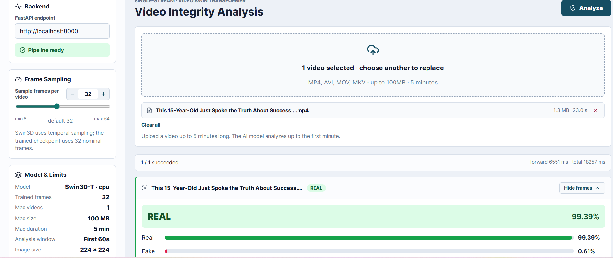
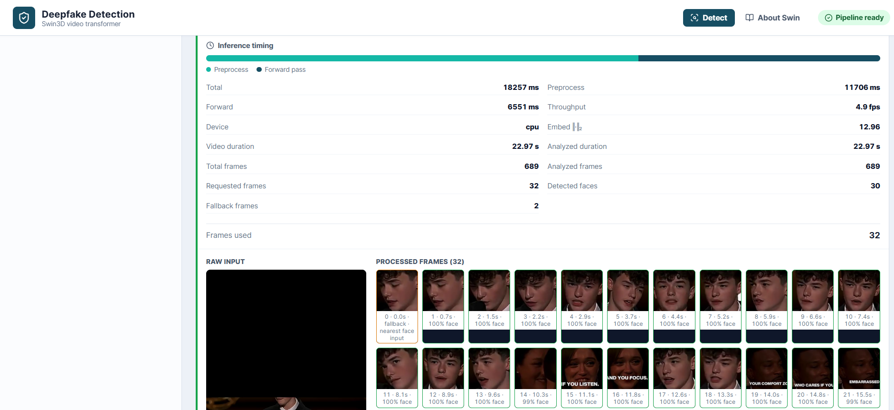
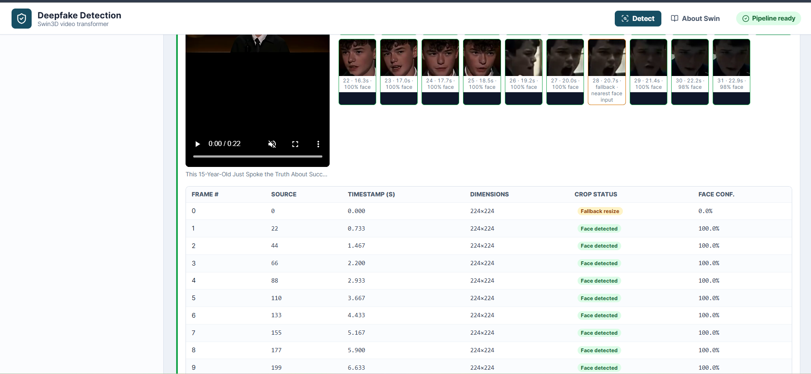
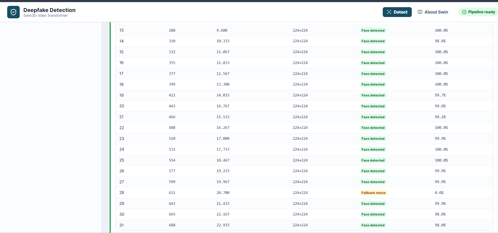

# Deepfake Video Detection with Swin3D

A final-year project that classifies an uploaded video as **Real** or **Fake** using a Swin3D-T video transformer fine-tuned with LoRA. The inference pipeline detects faces with MTCNN, samples frames, and returns prediction scores, timing information, and per-frame diagnostics through a FastAPI backend and React dashboard.

## Dashboard result screenshots

The screenshots below show a sample dashboard run. The displayed prediction and confidence are outputs from that particular video and run; they are not a general accuracy claim.

### Prediction and dashboard



### Inference metrics and extracted frame gallery



### Frame diagnostics





The captured run shown in the dashboard reports a 22.97-second video, 32 requested frames, and these timings:

| Metric | Captured value |
|---|---:|
| Preprocessing | 11,706 ms |
| Model forward pass | 6,551 ms |
| Total inference | 18,257 ms |
| Device | CPU |

These values describe the screenshot's single example run and will vary with video content and hardware.

## Pipeline

1. Upload one MP4, AVI, MOV, or MKV video (maximum 100 MB and 5 minutes).
2. The backend analyzes up to the first 60 seconds. Videos shorter than a minute are analyzed in full.
3. It samples frames from that portion and detects faces using MTCNN.
4. Face crops are resized and normalized for the trained Swin3D-T model. Missing detections use the nearest detected face crop for model input when one is available; diagnostics preserve the failed detection status.
5. The model returns Real/Fake probabilities, confidence, timings, and frame metadata.

The trained model settings are in `backend/models/swin_config.json` and `backend/models/mtcnn_config.json`. The inference implementation preserves the shipped checkpoint and configuration.

## Run locally

### Backend

Use Python 3.10 or newer. From the repository root:

```powershell
python -m venv .venv
.venv\Scripts\Activate.ps1
pip install -r backend/requirements.txt
uvicorn main:app --app-dir backend --reload --host 0.0.0.0 --port 8000
```

The backend loads the checkpoint and pretrained weights from `backend/models` and its cache. Open `http://localhost:8000/` to check service health and `http://localhost:8000/docs` to view the API.

### Frontend

In a second terminal:

```powershell
cd frontend
npm install
npm run dev
```

Open the Vite URL printed in the terminal (usually `http://localhost:5173`). The dashboard uses `http://localhost:8000` as its default API endpoint.

## Limits and notes

- One video per request; maximum file size is 100 MB.
- Uploaded video duration is limited to 5 minutes; analysis uses up to the first 60 seconds.
- Frame sampling accepts 8–64 frames, with 32 as the default and trained nominal frame count.
- The model's confidence is a prediction score, not a guarantee. Performance depends on the video and the model's training coverage.
- CPU and CUDA inference are selected automatically based on PyTorch availability.
